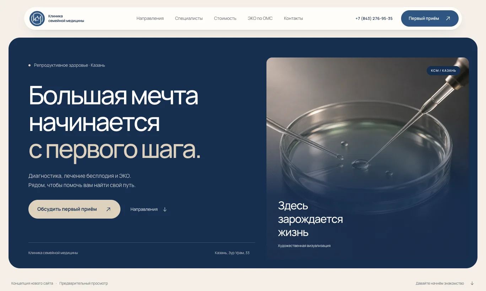

# КСМ — концепция главной страницы

[Открыть презентационный сайт](https://manath-iq.github.io/medic_corp/)

Интерактивный вариант главной страницы клиники репродуктивной медицины в Казани. Это **презентационная концепция, а не официальный сайт клиники** и не готовый многостраничный медицинский ресурс.



Текущая цветовая версия: глубокий тёмно-синий, тёплые бежевые фоны и фарфоровые поверхности. Видео на первом экране пока не добавлено.

## Что можно посмотреть

- Веер направлений: нажатие на всю карточку, горизонтальное листание, клавиатура и перетаскивание.
- Реальные специалисты и фильтр консультаций по категориям.
- Два маршрута ЭКО по ОМС: Татарстан и другие регионы РФ.
- Три шага к первому визиту с линией прогресса чтения.
- Нативный FAQ, мобильная навигация, поддержка reduced motion.
- Компактный мобильный первый экран с изображением, выбор направления и раскрываемый список консультаций.
- Выбранные реальные отзывы с Яндекс Карт и блок проезда с картой, включаемой по нажатию.

Запись, личный кабинет, CMS, интеграция с МИС и серверная обработка заявок здесь не реализованы. Контактные действия ведут к телефону клиники. Форм сбора персональных данных и собственной аналитики нет. Карта не загружается до нажатия кнопки; после включения браузер подключается к Яндексу, который может использовать cookies и собирать технические данные. Страница помечена `noindex,nofollow`, но ссылка публичная, это не контроль доступа.

## Запуск

Node.js 24 LTS и npm:

```sh
npm ci
npm run dev
```

Адрес: `http://localhost:4173/medic_corp/`.

```sh
npm run build
npm run preview
```

Предпросмотр сборки: `http://localhost:4174/medic_corp/`.

## Устройство

React + TypeScript + Vite; GSAP/ScrollTrigger; Phosphor; локальные шрифты Manrope.

- `src/App.tsx` — главная страница и навигация.
- `src/DirectionFan.tsx` — веер направлений.
- `src/ClinicTrust.tsx` — отзывы и карта проезда.
- `src/yandex.ts` — источник карты и статический снимок публичных отзывов/рейтинга, не автоматическая синхронизация.
- `src/LandingSections.tsx` — ОМС, первые шаги, о клинике и FAQ.
- `src/data.ts` — содержание и ссылки.
- `src/media.ts` — локальные изображения и резервные варианты.
- `src/styles.css` — палитра, адаптивные стили и состояния.
- `scripts/publish-pages.py` — публикация готовой сборки в отдельную ветку `gh-pages`. В неё попадают только файлы сайта, не исходники и не внутренние документы.

Во время просмотра изображения, шрифты и библиотеки загружаются с того же сайта. Ссылки на действующий сайт КСМ открываются только по действию посетителя. Для установки зависимостей и публикации нужен интернет; ключи API не требуются.

GitHub Pages настроен на `gh-pages` и корень ветки. Для обновления после коммита исходников: `npm run build`, затем `python3 scripts/publish-pages.py`. Нужны Git, Python 3 и авторизованный GitHub CLI с правом записи в репозиторий. Workflow и расширение OAuth-прав не требуются.

## Проверка

TypeScript и production-сборка проверены. UI-тесты пройдены в Chromium и WebKit на 320/390/768/1024/1440 px; переключение региона и FAQ проверены клавиатурой, линия чтения — в обе стороны; reduced motion — на 390/1440 px. Автоматическая проверка axe восьми основных разделов не нашла нарушений в проверенных состояниях. Карусель проверена на клики, горизонтальный wheel, drag/cancel, клавиатуру и touch tap; native touch swipe и вертикальная touch-прокрутка — в Chromium. Это не проверка конкретной версии Safari или физического устройства и не подтверждение полной нормативной готовности медицинского сайта.

Опциональный `scripts/verify-landing.mjs` использует `playwright-core` и `axe-core`, установленные отдельно от production-зависимостей. `QA_TOOLS_DIR` указывает их npm-prefix, `QA_URL` — проверяемый адрес, `QA_OUTPUT_DIR` — каталог отчёта; `CHROME_PATH` позволяет указать установленный Chrome.

`QA_BROWSER=chromium|webkit` выбирает движок. `scripts/verify-direction-fan.mjs` отдельно проверяет карусель и мобильные контролы, поддерживает также `QA_BROWSER=both`. Для WebKit нужен установленный Playwright-браузер; в мобильном WebKit wheel проверяется синтетически из-за ограничения инструмента, на desktop используется browser wheel.

## Материалы и ограничения

Композиционные приёмы адаптированы из собственного проекта [DENTIS](https://github.com/Manath-iq/stomatologiya). Содержание стоматологического примера, вымышленные сотрудники и его показатели не использованы.

Логотип, фотографии специалистов и диагностического оборудования взяты из публичных материалов [КСМ](https://ksm-eko.ru/) для демонстрации. Лица и логотип не изменены. Предметные изображения в `src/assets/generated/` — художественные визуализации, не фотографии помещений, пациентов или результата лечения.

Медицинские тексты, цены, сведения о сотрудниках и права на материалы необходимо подтвердить с клиникой перед официальным запуском. Публикация этого репозитория не предоставляет отдельного разрешения на повторное использование фирменных материалов клиники. Общая лицензия на повторное использование проекта не установлена.
